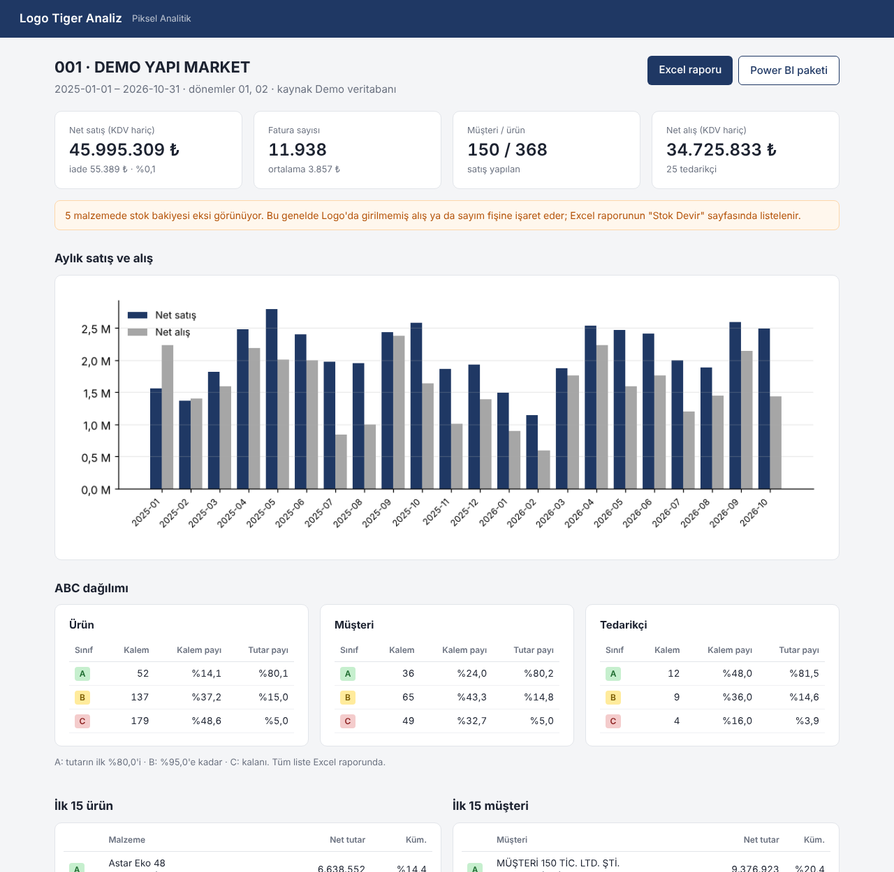
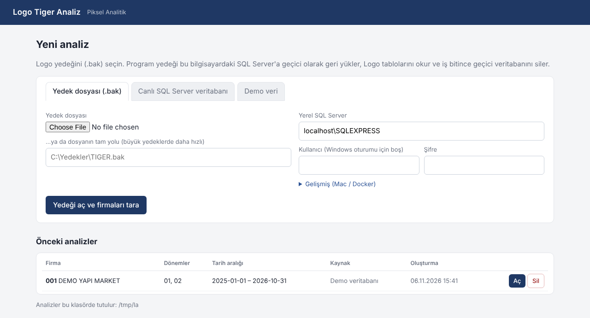
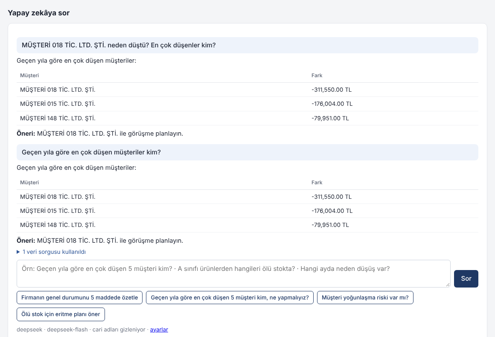

# Logo Tiger Analiz

[](../../releases/latest)
[](../../actions/workflows/entegrasyon.yml)
[](LICENSE)

**Logo Tiger yedeğinden (`.bak`) dakikalar içinde satış, kârlılık, alacak, stok, müşteri ve tedarikçi analizi.**
Firmaya gidin, programı açın, yedeği seçin; Excel raporunu, tek sayfalık PDF yönetici özetini ya da Power BI paketini alın.

Elle hiçbir şey kurmanız gerekmez: yedeği açmak için gereken SQL Server bilgisayarda yoksa program onu kendisi kurar.
Her şey kendi bilgisayarınızda çalışır; isteğe bağlı yapay zekâ özelliğini açmadığınız sürece hiçbir veri internete gönderilmez.



---

## İçindekiler
- [Hızlı başlangıç (fabrikada kullanım)](#hızlı-başlangıç-fabrikada-kullanım)
- [SQL Server: otomatik kurulum](#sql-server-otomatik-kurulum)
- [Analizler](#analizler)
- [Çıktılar](#çıktılar)
- [Yapay zekâ](#yapay-zekâ)
- [Logo verisi nasıl yorumlanıyor](#logo-verisi-nasıl-yorumlanıyor)
- [Güvenlik ve KVKK](#güvenlik-ve-kvkk)
- [Sorun giderme](#sorun-giderme)
- [Kaynaktan çalıştırma ve geliştirme](#kaynaktan-çalıştırma-ve-geliştirme)
- [Lisans](#lisans)

---

## Hızlı başlangıç (fabrikada kullanım)

1. **İndirin.** [Releases](../../releases/latest) sayfasından sisteminize uygun dosyayı indirin:

   | Sistem | Dosya |
   |---|---|
   | Windows 10/11 (64 bit) | `LogoTigerAnaliz-windows-x64.zip` |
   | macOS (M1/M2/M3/M4) | `LogoTigerAnaliz-macos-apple-silicon.zip` |
   | Linux (64 bit) | `LogoTigerAnaliz-linux-x64.tar.gz` |

2. **Açın.** Arşivi çıkarın ve `LogoTigerAnaliz` klasöründeki programı çalıştırın
   (Windows'ta `LogoTigerAnaliz.exe`). Tarayıcıda **http://127.0.0.1:5055** kendiliğinden açılır.
   Siyah pencere programın kendisidir; iş bitene kadar kapatmayın.
   - Windows "Windows kişisel bilgisayarınızı korudu" derse: **Ek bilgi → Yine de çalıştır**.
   - macOS "açılamıyor" derse, Terminal'de bir kez: `xattr -dr com.apple.quarantine ~/Downloads/LogoTigerAnaliz`
3. **Yedeği seçin ve Başlat'a basın.** Firmadan **iki** `.bak` geldiyse (biri genelde küçük `LOGODB`: firma adları
   ve dönemler; diğeri firma verileri) ikincisini **İkinci yedek var mı?** alanına koyun; program ikisini birleştirir,
   hangisinin hangisi olduğunu kendisi anlar. İlk seferde program kendi SQL Server'ını kurar
   (internet gerekir, ~5 dakika; Windows "yönetici izni" sorduğunda **Evet** deyin). Sonraki açılışlarda bu adım atlanır.
4. **Firma ve dönem seçin.** Program yedekteki tüm Logo firmalarını ve dönemlerini kendisi bulur. Çok firmalı
   yedeklerde arama kutusuyla firmayı bulun. Tek firma seçerseniz yalnızca o firma analiz edilir.
   Şirket Logo'da **her yıl ayrı firma** olarak açıldıysa o yılların firmalarını birlikte işaretleyin: tek analizde
   birleşir, müşteri ve ürünler koduna göre eşleştirilir; stok ve cari bakiye en yeni yılın firmasından alınır.
   Başka bir firmayı da analiz edecekseniz *Sonra başka firmayı da analiz edeceğim* kutusunu işaretleyin (yedek yeniden açılmaz).
5. **Raporu alın.** Panelde özet görünür; **Excel raporu** ya da **PDF özet** düğmesiyle indirin, **Power BI raporu aç** ile hazır raporu Power BI'da açın.

> Program yedeği geçici bir veritabanına (`LOGOANALIZ_XXXXXXXX`) geri yükler, verileri okur ve bu geçici veritabanını
> **siler**. Firmanın kendi Logo veritabanına dokunulmaz, yazılmaz.

> İnternet olmayan bir yere gidecekseniz programı önceden kendi laptopunuzda bir kez çalıştırıp SQL Server'ı kurdurun;
> sahada internet gerekmez.

Önce denemek isterseniz **Demo veri** sekmesi, Logo tablo yapısında üretilmiş örnek bir firmayla çalışır.



## SQL Server: otomatik kurulum

`.bak` dosyası bir SQL Server yedeğidir ve yalnızca SQL Server tarafından açılabilir. Bunu program halleder:

| Sistem | Program ne yapar |
|---|---|
| **Windows** | Microsoft'un ücretsiz **SQL Server 2022 Express** sürümünü indirir ve `LOGOANALIZ` adıyla sessizce kurar. Sizden sadece Windows'un yönetici izni penceresine "Evet" demeniz istenir. Rastgele üretilen `sa` şifresi Windows DPAPI ile şifrelenip `LogoAnaliz\ayarlar.json`'da saklanır. Port `14330`, yedek klasörü `C:\ProgramData\LogoAnaliz\yedek`. Firmanın kendi Logo SQL Server'ına dokunulmaz. |
| **macOS** | [Docker Desktop](https://www.docker.com/products/docker-desktop/) kuruluysa SQL Server konteynerini (`logo-analiz-mssql`) kendisi oluşturur ve başlatır. Docker ayarlarında *Use Rosetta for x86_64/amd64 emulation* açık olmalı. |
| **Linux** (64 bit Intel/AMD) | Docker kuruluysa konteyneri kendisi oluşturur ve başlatır. Docker'ı bir kez kurmak için: `curl -fsSL https://get.docker.com \| sudo sh && sudo usermod -aG docker $USER`, sonra oturumu kapatıp açın. Power BI Desktop Linux'ta yoktur; Excel raporu LibreOffice'te grafikleriyle açılır. |

İsterseniz *Bu bilgisayardaki başka bir SQL Server* seçeneğiyle mevcut bir sunucuyu (ör. Logo'nun kendi örneği, kullanıcı `sa`)
da kullanabilirsiniz; program bilgisayardaki örnekleri listeler.

Bu akış her kod değişikliğinde GitHub Actions'ta **gerçek bir Windows makinesinde** baştan sona test edilir:
SQL Server Express programın kendi koduyla kurulur, Logo yapısında bir veritabanından `.bak` alınır, uygulama bu yedeği
geri yükleyip analiz eder ve sonuçlar kuruşu kuruşuna karşılaştırılır ([tests/entegrasyon.py](tests/entegrasyon.py)); Linux/Docker yolu da aynı testle Ubuntu üzerinde doğrulanır.

> Yedek, kurulu SQL Server'dan **daha yeni** bir sürümle alınmışsa geri yüklenemez. Program SQL Server 2022 kurar;
> Logo'nun kullandığı 2012–2022 sürümlerinin yedeklerini açar.

## Analizler

| Analiz | İçerik |
|---|---|
| **Özet** | Net satış, iade tutarı ve oranı, fatura sayısı, ortalama fatura, müşteri/ürün sayısı, net alış |
| **Ürün ABC** | Net satış tutarına göre A/B/C sınıfları, Pareto grafiği. Sınırlar ayarlanabilir (varsayılan %80 / %95) |
| **Müşteri ABC** | Net satış, fatura sayısı, son alım tarihi |
| **Tedarikçi ABC** | Net alış tutarına göre |
| **Aylık trend** | Aylık satış/alış ve geçen yılın aynı ayına göre değişim |
| **Grup satış** | Malzeme grubu (`STGRPCODE`) kırılımı |
| **Ölü stok** | Elde olup N gündür satılmayan malzemeler ve ortalama alış maliyetiyle tahmini değeri |
| **Stok devir** | Devir hızı, stok yeterlilik süresi (gün), negatif stok uyarısı |
| **Kârlılık** | Ürün, müşteri ve grup bazında tahmini brüt kâr ve marj (son alış maliyetiyle); en düşük marjlı ürünler |
| **Alacak / borç yaşlandırma** | Cari bakiyeler 0-30 / 31-60 / 61-90 / 91-180 / 180+ gün dilimlerinde; ortalama tahsilat süresi |
| **Satış temsilcisi** | Temsilci bazında net satış, pay, fatura ve müşteri sayısı, iade, tahmini kâr |
| **Müşteri kaybı** | Düzenli alırken alımı kesilen (Kayıp) ya da seyrekleşen (Risk) müşteriler |
| **Sipariş önerisi** | Stoğu 15 günden az yetecek ürünler, önerilen miktar, son tedarikçi ve tahmini tutar |
| **Depo kırılımı** | Ambar bazında satış, stok kalemi ve stok değeri (birden fazla ambar varsa) |
| **Öne çıkanlar** | Yönetimin ilk bakması gereken noktalar; kural tabanlı, yapay zekâ gerektirmez |

Kârlılık, alacak, temsilci ve depo analizleri yedekte ilgili Logo tabloları varsa çıkar; yoksa o bölüm gösterilmez.

## Çıktılar

- **Panel**: tarayıcıda özet, öne çıkanlar, grafikler, ilk 15 ürün/müşteri, ölü stok, kârlılık, alacak yaşlandırma,
  müşteri kaybı, sipariş önerisi, temsilci ve depo tabloları.
- **Excel raporu** (`.xlsx`): Özet, Ürün/Müşteri/Tedarikçi ABC (Pareto grafiğiyle), Aylık Trend, Grup Satış,
  Ölü Stok, Stok Devir, Ürün/Müşteri/Grup Kârlılık, Alacak/Borç Yaşlandırma, Temsilci, Müşteri Kaybı, Sipariş Önerisi,
  Depo sayfaları. Filtreli, dondurulmuş başlıklı, A4 yatay yazdırmaya hazır.
- **PDF yönetici özeti** (`.pdf`): yönetime sunulacak tek sayfa A4; temel göstergeler, aylık grafik, ilk 5 ürün ve
  müşteri, alacak yaşlandırma, öne çıkanlar.
- **Hazır Power BI raporu**: paneldeki **Power BI raporu aç** düğmesi beş sayfalık raporu (Özet, Kârlılık, Alacak,
  Müşteri ve Temsilci, Stok) üretip Power BI Desktop'ta açar; veriler kendiliğinden yüklenir, ilişkiler ve ölçüler
  hazırdır. Windows'ta [Power BI Desktop](https://www.microsoft.com/store/productId/9NTXR16HNW1T) (ücretsiz) gerekir.
- **Power BI paketi** (`.zip`): hazır rapor (`.pbit`) ve yıldız şema CSV'leri (`fact_satis`, `fact_alis`, `fact_cari_hareket`, `dim_cari`,
  `dim_malzeme`, `dim_tarih`, `dim_temsilci`, `dim_ambar`, `stok_bakiye`, `stok_ambar`, ABC ve hazır analiz tabloları)
  ve ilişkileri/DAX ölçülerini (brüt kâr, cari bakiye dahil) anlatan `OKUBENI_PowerBI.txt`.
  Power BI Desktop yalnızca Windows'ta çalışır.

Her analiz `~/LogoAnaliz/` (Windows: `C:\Users\<kullanıcı>\LogoAnaliz\`) altında saklanır;
firmadan ayrıldıktan sonra programı açıp **Önceki analizler** listesinden tekrar açabilirsiniz.

## Yapay zekâ

Analizleri yapay zekâya yorumlatmanın üç yolu var (**Yapay zekâ ayarları** sayfası). Hiçbiri zorunlu değildir.

| Yol | Kimin için | Ne olur |
|---|---|---|
| **API anahtarı** | Gemini (ücretsiz katman), DeepSeek (çok ucuz), OpenAI, Claude API | Panelde **Yapay zekâya sor** kutusu; Excel raporuna **YZ Yorumu** sayfası (yönetici yorumu). |
| **Claude Desktop** | Claude Pro aboneliği olanlar (ek ücret yok) | Tek tıkla program Claude Desktop'a bağlanır; Claude analizleri doğrudan buradan okur ve sorgular. |
| **Yapay zekâ paketi** | ChatGPT Plus ve diğer tüm sohbet uygulamaları | Panelden zip indirilir (özet, tablolar, hazır ilk mesaj); sohbete sürükleyip bırakılır. |



- **Abonelikler hakkında:** ChatGPT Plus / Claude Pro gibi aylık abonelikler başka programlara API erişimi vermez.
  Bu yüzden abonelik kullananlar için Claude Desktop bağlantısı ve yapay zekâ paketi var; API anahtarı ayrı ücretlendirilir.
- **Model seçimi otomatiktir:** anahtar test edilirken sağlayıcının güncel model listesi çekilir ve uygun model seçilir;
  bir model emekliye ayrılırsa "Bağlantıyı test et" yeterlidir.
- **Nasıl cevaplıyor:** yapay zekâ önce analizin özetini (ABC, trend, geçen yıl karşılaştırması, ölü stok…) görür.
  Gerekirse analiz veritabanında **salt-okur** SQL sorgusu ister; program sorguyu çalıştırıp sonucu verir (en fazla 4 tur).
  Kullanılan sorgular cevabın altında görünür.

### Gizlilik (KVKK)
- **Anonimleştirme varsayılan olarak açıktır:** cari ve firma adları yapay zekâya `Cari-0012`, `FİRMA` gibi takma adlarla gider;
  cevap ekranda gerçek adlarla gösterilir. Eşleme tablosu bilgisayardan çıkmaz. Aynı kural Claude Desktop bağlantısında ve
  yapay zekâ paketinde de geçerlidir. Bu davranış testlerde, servise giden her istek taranarak doğrulanır.
- Yapay zekâya ham fatura satırları değil, özet tablolar ve sorgu sonuçları gider.
- API anahtarı diskte şifreli saklanır (Windows: DPAPI).
- Sağlayıcı seçerken dikkat: Gemini'nin ücretsiz katmanında Google veriyi ürün geliştirmek için kullanabilir;
  DeepSeek'in sunucuları Çin'dedir (yurt dışına veri aktarımı). Hassas firmalarda ücretli katman veya anonimleştirme önerilir.

## Logo verisi nasıl yorumlanıyor

Ham Logo tabloları doğrudan toplandığında ciro yanlış çıkar. Program şu kuralları uygular:

| Konu | Kural |
|---|---|
| Tablolar | `LG_{firma}_CLCARD` (cari), `LG_{firma}_ITEMS` (malzeme), `LG_{firma}_{dönem}_INVOICE`, `LG_{firma}_{dönem}_STLINE` |
| Satış | `TRCODE` 7 (perakende) ve 8 (toptan); iadeler 2 ve 3 **eksi** olarak düşülür |
| Alış | `TRCODE` 1; alış iadesi 6 eksi |
| İptal | `STLINE.CANCELLED=1` veya bağlı faturası iptal olan satırlar dışlanır |
| Satır tipi | Sadece malzeme satırları (`LINETYPE=0`); indirim/masraf satırları dışlanır (hizmetler isteğe bağlı) |
| Tutar | **`VATMATRAH`**: KDV hariç net, dip indirimler satırlara dağıtılmış hali |
| İrsaliye | Faturalanmamış irsaliyeler varsayılan olarak satışa sayılmaz (ayarlanabilir) |
| Birim | Koli/paket gibi alt birimler ana birime çevrilir: `AMOUNT × UINFO2 / UINFO1` |
| Stok | En son seçilen dönemden hesaplanır (dönem başı devir fişi önceki bakiyeyi taşır) |
| Maliyet | Her satışa, o malzemenin satış tarihinden önceki en son alış (yoksa devir/üretim girişi) birim fiyatı atanır. Logo'nun maliyetlendirme servisi gerekmez; sonuç tahmini brüt kârdır, muhasebe kârı değildir |
| Cari bakiye | `LG_{firma}_{dönem}_CLFLINE`, en son seçilen dönem; `SIGN=0` borç, `SIGN=1` alacak, iptaller hariç; tutarlar KDV dahil |
| Yaşlandırma | Ödemeler en eski kayıttan düşülür (FIFO); kalan açık tutar hareket tarihine göre dilimlenir. Devir fişiyle gelen bakiye dönem başı tarihiyle yaşlanır |
| Temsilci / ambar | `STLINE.SALESMANREF` (boşsa faturadaki) → `LG_SLSMAN`; `STLINE.SOURCEINDEX` → `L_CAPIWHOUSE` |

Panelin altındaki **Veri notları** kaç satırın neden dışlandığını gösterir.

## Güvenlik ve KVKK

- Program sadece `127.0.0.1` üzerinden çalışır; ağdaki başka bilgisayarlar erişemez. Yapay zekâ kullanılmadıkça veri internete gönderilmez;
  kullanıldığında da varsayılan olarak cari/firma adları gizlenir ([Yapay zekâ](#yapay-zekâ)).
- Programın kurduğu SQL Server sadece bu bilgisayardan erişilir; `sa` şifresi rastgele üretilir ve şifreli saklanır.
- Firmanın Logo veritabanında yalnızca `SELECT` çalıştırılır. Yedekten açılan geçici veritabanı iş bitince silinir;
  tarayıcıdan yüklenen `.bak` kopyası da silinir.
- Analiz klasörü (`~/LogoAnaliz/`) cari adları ve satış tutarları içerir. İş bittiğinde **Önceki analizler → Sil**
  ile kaldırabilir, ya da yalnızca rapor dosyalarını firmaya teslim edebilirsiniz.
- Repo `.gitignore`'u `.bak`, `.mdf`, `.xlsx` gibi dosyaların yanlışlıkla GitHub'a gönderilmesini engeller.

## Sorun giderme

| Mesaj | Çözüm |
|---|---|
| *SQL Server Express indirilemedi* | İnternet bağlantısını kontrol edin. Kurumsal ağlarda Microsoft indirmeleri engelli olabilir; programı önce başka bir ağda bir kez çalıştırıp kurulumu tamamlayın. |
| *Yönetici izni verilmedi* | Kurulum için Windows'un izin penceresinde "Evet" gerekir. Yönetici hesabınız yoksa BT'den yardım isteyin ya da "başka bir SQL Server" seçeneğiyle firmanın mevcut sunucusunu kullanın. |
| *SQL Server kurulumu başarısız (kod …)* | Ayrıntılar `C:\Program Files\Microsoft SQL Server\…\Setup Bootstrap\Log\Summary.txt` içinde. Bekleyen Windows güncellemesi varsa bilgisayarı yeniden başlatıp tekrar deneyin. |
| *Yerel SQL Server'a bağlanılamadı* (elle seçilen sunucu) | Servis çalışıyor mu, sunucu adı doğru mu? Adlandırılmış örneklerde (`PC\SQLEXPRESS`) *SQL Server Browser* servisi açık ve TCP/IP etkin olmalı. Kullanıcı/şifre (genelde `sa`) doğru mu? |
| *Yedek okunamadı… Operating system error 5* | SQL Server servisinin dosyayı okuma izni yok. `.bak`'ı SQL Server'ın `Backup` klasörüne (ör. `C:\Program Files\Microsoft SQL Server\MSSQL15.SQLEXPRESS\MSSQL\Backup`) koyup tam yolunu yazın. |
| *…is incompatible with this server* | Yedek daha yeni bir SQL Server sürümüyle alınmış; bilgisayardaki SQL Server'ı güncelleyin. |
| *Logo firma tabloları bulunamadı* | Yedek Logo Tiger/Go veritabanı değil. |
| *…yalnızca Logo'nun sistem veritabanı (LOGODB)* | Sadece `LOGODB` yedeği seçilmiş. Firma verilerinin olduğu yedeği de **İkinci yedek** alanına ekleyin. |
| Firma listesinde adlar boş | Firma adları ayrı `LOGODB` yedeğinde duruyor; o yedeği de ikinci yedek olarak ekleyin. |
| Port 5055 dolu | `LOGO_ANALIZ_PORT=5056` ortam değişkeniyle başka port kullanın. |

Herhangi bir sorunda sayfanın altındaki **Tanılama paketi** bağlantısıyla bir zip indirip [Issues](../../issues)'a ekleyin.
Paket günlükleri ve sistem bilgisini içerir; müşteri verisi, firma ve kullanıcı adları içermez.

## Kaynaktan çalıştırma ve geliştirme

Python 3.11+ gerekir.

```bash
git clone https://github.com/mdrmz/Piksel_STDIO-LOGO-TIGER.git
cd Piksel_STDIO-LOGO-TIGER
python -m venv .venv && . .venv/bin/activate        # Windows: .venv\Scripts\activate
pip install -r requirements.txt
python demo/demo_db_olustur.py demo/logo_demo.sqlite
python app.py
```
Ya da hazır betikler: `calistir_windows.bat`, `calistir_mac.command`, `calistir_linux.sh`.

**Testler:** `pip install pytest && pytest -q tests`. Testler, uygulamanın sonuçlarını ham Logo tablolarından
düz SQL ile hesaplanan değerlerle karşılaştırır. GitHub Actions ayrıca her değişiklikte gerçek Windows ve Linux
makinelerde SQL Server'ı kurup `.bak` geri yükleme akışını hem kaynak koddan hem paketlenmiş programla sınar
(`tests/entegrasyon.py`, `tests/paket_testi.py`). Sürüm geçmişi: [CHANGELOG.md](CHANGELOG.md).

**Tek klasörlük paket derleme:** `pip install pyinstaller && pyinstaller LogoTigerAnaliz.spec --noconfirm`
→ `dist/LogoTigerAnaliz/`

**Yeni sürüm yayınlama:** `core/__init__.py` içindeki `__version__` değerini artırıp (ör. `"0.4.1"`) `main`'e gönderin.
GitHub Actions testleri çalıştırır, üç sistem için paketleri derler, `v0.4.1` etiketini ve Release'i kendisi oluşturur.

**Klasör yapısı**
```
app.py                 yerel web arayüzü (Flask, sadece 127.0.0.1)
core/kurulum.py        SQL Server'ın otomatik kurulumu (Windows: Express, macOS/Linux: Docker)
core/kaynak.py         .bak geri yükleme, SQL Server ve SQLite bağlantıları
core/logo.py           firma/dönem tarama, Logo tablolarından temiz modele aktarım
core/analiz.py         ABC, trend, ölü stok, stok devir, kârlılık, cari yaşlandırma, temsilci, müşteri kaybı, sipariş önerisi, depo
core/rapor.py          Excel raporu ve Power BI paketi
core/pdf_ozet.py       tek sayfalık PDF yönetici özeti
core/powerbi.py        hazır Power BI raporu (.pbit): model, ölçüler ve rapor sayfaları
core/yz.py             yapay zekâ: sağlayıcılar, anonimleştirme, soru-cevap, yönetici yorumu
core/mcp_sunucu.py     Claude Desktop bağlantısı (MCP, `--mcp`)
core/yzpaket.py        ChatGPT vb. için yapay zekâ paketi
core/tanilama.py       işlem günlüğü ve tanılama paketi
demo/                  Logo yapısında örnek veri üretici
templates/             arayüz sayfaları
tests/                 uçtan uca testler + gerçek Windows/SQL Server entegrasyon testi
.github/workflows/     otomatik test, derleme ve sürüm yayınlama
```

Katkılar ve hata bildirimleri için [Issues](../../issues) kullanabilirsiniz. Hata bildirirken bekleme ekranındaki
log çıktısını ekleyin (müşteri verisi içeren dosyaları **eklemeyin**).

---

### English summary
Local tool that restores a **Logo Tiger** ERP backup (`.bak`) into a temporary database on the local SQL Server,
extracts sales/purchase/stock/receivables data with Logo-specific cleaning rules, and produces ABC analysis (products,
customers, suppliers), monthly trends, dead stock, stock turnover, estimated gross margin, receivables/payables aging,
salesperson performance, customer churn, reorder suggestions and warehouse breakdown as a web dashboard, an Excel
workbook, a one-page PDF executive summary and a Power BI-ready star schema, plus optional AI Q&A (Gemini, DeepSeek, OpenAI, Claude API, Claude Desktop via MCP)
with customer-name anonymization. Runs entirely on `127.0.0.1`; without AI, no data leaves the machine.
Download a build from [Releases](../../releases/latest) (Windows, macOS, Linux).

## Lisans

[MIT](LICENSE) © 2026 Piksel Analitik. Logo, Logo Tiger ve Logo Go, Logo Yazılım'ın markalarıdır; bu proje Logo Yazılım ile
bağlantılı değildir.
